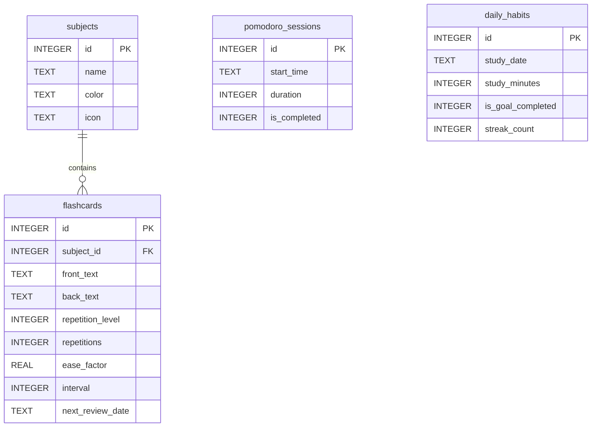

# StudyMate AI - SQLite Database ERD

## 1. So do quan he du lieu

## 2. Mo ta

- subjects: Luu danh sach mon hoc.
- flashcards: Luu the ghi nho va thong tin on tap SM-2.
- pomodoro_sessions: Luu lich su cac phien hoc.
- daily_habits: Theo doi thoi quen hoc tap.

## 3. Quan he

subjects (1) -- (N) flashcards

Moi flashcard thuoc ve mot mon hoc.
Khi xoa mon hoc, cac flashcard lien quan
se duoc xoa theo (ON DELETE CASCADE).

## 4. Database

- Database: studymate.db
- Version: 2
- Framework: Flutter
- Storage: SQLite (sqflite)
