# TỔNG HỢP HỆ THỐNG ỨNG DỤNG FLUTTER & ĐỀ CƯƠNG ĐỒ ÁN CUỐI KỲ

> **Tài liệu trung tâm:** Tổng hợp phân tích các dự án hiện có tại `d:\Code\Flutter\projects` và Đề cương chi tiết phát triển đồ án tốt nghiệp / đồ án môn học: **Ứng dụng Hỗ trợ Học tập Thông minh & Rèn luyện Kỷ luật tích hợp Trí tuệ Nhân tạo (StudyMate AI)** mở rộng từ EnglishSpeech AI.

---

## 📑 MỤC LỤC TỔNG THỂ

- [PHẦN I: TỔNG HỢP & PHÂN TÍCH HỆ THỐNG ỨNG DỤNG ĐÃ THIẾT KẾ](#phần-i-tổng-hợp--phân-tích-hệ-thống-ứng-dụng-đã-thiết-kế)
  - [1. Bảng Tổng Hợp Nhanh Hệ Sinh Thái Ứng Dụng](#1-bảng-tổng-hợp-nhanh-hệ-sinh-thái-ứng-dụng)
  - [2. Phân Tích Chi Tiết Từng Ứng Dụng](#2-phân-tích-chi-tiết-từng-ứng-dụng)
    - [2.1. Cashew — Quản Lý Tài Chính & Ngân Sách](#21-cashew--quản-lý-tài-chính--ngân-sách-cá-nhân)
    - [2.2. Daily You — Nhật Ký & Lưu Giữ Khoảnh Khắc](#22-daily-you--nhật-ký--lưu-giữ-khoảnh-khắc-đời-sống)
    - [2.3. Document Management — Quản Lý & Mượn Trả Tài Liệu Học Tập](#23-document-management--quản-lý--mượn-trả-tài-liệu-học-tập)
    - [2.4. EnglishSpeech AI — Luyện Phát Âm AI & Kỷ Luật Học Tập](#24-englishspeech-ai--luyện-phát-âm-ai--kỷ-luật-học-tập)
    - [2.5. Personal (Habit Tracker) — Rèn Luyện Kỷ Luật Bản Thân](#25-personal-habit-tracker--rèn-luyện-kỷ-luật-bản-thân)
    - [2.6. flutter_application_1 — Hồ Sơ Năng Lực Cá Nhân (Portfolio)](#26-flutter_application_1--hồ-sơ-năng-lực-cá-nhân-portfolio)
    - [2.7. Project-Group19 — Khung Quản Trị Dự Án & CI/CD Nhóm 19](#27-project-group19--khung-quản-trị-dự-án--cicd-nhóm-19)
  - [3. Đánh Giá Năng Lực Kỹ Thuật Đạt Được](#3-đánh-giá-năng-lực-kỹ-thuật-đạt-được)
- [PHẦN II: ĐỀ CƯƠNG CHI TIẾT ĐỒ ÁN CUỐI KỲ (STUDYMATE AI)](#phần-ii-đề-cương-chi-tiết-đồ-án-cuối-kỳ-studymate-ai)
  - [1. Thông Tin Chung & Lý Do Chọn Đề Tài](#1-thông-tin-chung--lý-do-chọn-đề-tài)
  - [2. Mục Tiêu Nghiên Cứu & Phát Triển](#2-mục-tiêu-nghiên-cứu--phát-triển)
  - [3. Phạm Vi & Giới Hạn Đề Tài](#3-phạm-vi--giới-hạn-đề-tài)
  - [4. Phân Hệ & Chức Năng Chính](#4-phân-hệ--chức-năng-chính)
  - [5. Kiến Trúc Hệ Thống & Công Nghệ Áp Dụng](#5-kiến-trúc-hệ-thống--công-nghệ-áp-dụng)
  - [6. Kế Hoạch Thực Hiện Chi Tiết (Roadmap 12 Tuần)](#6-kế-hoạch-thực-hiện-chi-tiết-roadmap-12-tuần)
  - [7. Điểm Sáng Đồ Án & Tiêu Chí Nghiệm Thu](#7-điểm-sáng-đồ-án--tiêu-chí-nghiệm-thu)

---

# PHẦN I: TỔNG HỢP & PHÂN TÍCH HỆ THỐNG ỨNG DỤNG ĐÃ THIẾT KẾ

---

## 1. Bảng Tổng Hợp Nhanh Hệ Sinh Thái Ứng Dụng

| STT | Thư mục | Tên ứng dụng | Lĩnh vực / Mục đích | Kiến trúc & Công nghệ chính | Trạng thái |
| :---: | :--- | :--- | :--- | :--- | :---: |
| **1** | [Cashew](file:///d:/Code/Flutter/projects/Cashew) | **Cashew** | Quản lý tài chính cá nhân, ngân sách, hóa đơn | Flutter 3.x, Provider, Firebase Auth/Core, Home Widget, SQLite | Hoàn thiện (v5.4.3) |
| **2** | [Daily-you](file:///d:/Code/Flutter/projects/Daily-you) | **Daily You** | Nhật ký cá nhân, ghi âm giọng nói, bảo mật dữ liệu | Flutter 3.x, Provider, SQLite, Markdown Widget, Just Audio, SAF | Hoàn thiện (v3.7.0) |
| **3** | [Document-Management](file:///d:/Code/Flutter/projects/Document-Management) | **Document Management** | Số hóa, chia sẻ & mượn trả tài liệu học thuật | Clean Architecture, Supabase (PostgreSQL, Storage), Firebase FCM | Hoàn thiện (v1.0.0) |
| **4** | [EnglishSpeech](file:///d:/Code/Flutter/projects/EnglishSpeech) | **EnglishSpeech AI** | Phân tích phát âm AI & duy trì chuỗi kỷ luật học | Fullstack: Flutter (Client) + FastAPI, NLTK CMUDict (Backend) | Hoàn thiện (v1.0.0) |
| **5** | [Personal](file:///d:/Code/Flutter/projects/Personal) | **Habit Tracker** | Theo dõi thói quen, biểu đồ phân tích kỷ luật | Material 3, Provider, SQLite (sqflite), Custom Charts & Heatmap | Hoàn thiện (100%) |
| **6** | [flutter_application_1](file:///d:/Code/Flutter/projects/flutter_application_1) | **Personal Portfolio** | CV tương tác giới thiệu năng lực lập trình viên | Flutter Material 3, URL Launcher, Responsive Cards Layout | Hoàn thiện (v1.0.0) |
| **7** | [Project-Group19](file:///d:/Code/Flutter/projects/Project-Group19) | **Group 19 Framework** | Quy chuẩn cộng tác nhóm, CI/CD tự động | GitHub Actions (`pr-checks.yml`), Git Flow, PR Templates | Nền tảng / Chuẩn hóa |

---

## 2. Phân Tích Chi Tiết Từng Ứng Dụng

### 2.1. Cashew — Quản Lý Tài Chính & Ngân Sách Cá Nhân
* **Vị trí mã nguồn:** [Cashew/Cashew/budget](file:///d:/Code/Flutter/projects/Cashew/Cashew/budget) (Phiên bản `5.4.3+416`)
* **Mô tả:** Ứng dụng quản lý dòng tiền và kế hoạch tài chính toàn diện, hỗ trợ đa nền tảng (Android, iOS, Web).
* **Tính năng nổi bật:**
  - **Quản lý đa tài khoản & ví:** Thiết lập không giới hạn số lượng ví tiền mặt, thẻ ngân hàng, tài khoản đầu tư (`accountsPage.dart`, `addWalletPage.dart`).
  - **Phân bổ ngân sách & Mục tiêu:** Lập hạn mức chi tiêu định kỳ (`budgetPage.dart`), theo dõi mục tiêu tiết kiệm (`addObjectivePage.dart`).
  - **Tự động hóa giao dịch:** Phân tích giao dịch tự động qua mẫu email ngân hàng (`autoTransactionsPageEmail.dart`).
  - **Tiện ích mở rộng:** Công cụ chia hóa đơn nhóm (`billSplitter.dart`), hỗ trợ Widget màn hình chính (`home_widget`).
* **Công nghệ:** Provider, Firebase Auth & Core, SharedPreferences, SQLite.

---

### 2.2. Daily You — Nhật Ký & Lưu Giữ Khoảnh Khắc Đời Sống
* **Vị trí mã nguồn:** [Daily-you/Daily_You_Mobile](file:///d:/Code/Flutter/projects/Daily-you/Daily_You_Mobile) (Phiên bản `3.7.0+3007000`)
* **Khẩu hiệu:** *"Every day is worth remembering..."* (Phát hành F-Droid, IzzyOnDroid).
* **Tính năng nổi bật:**
  - **Soạn thảo Markdown toàn màn hình:** Hỗ trợ định dạng văn bản giàu tính năng (`full_screen_text_editor_page.dart`, `markdown_widget`).
  - **Nhật ký âm thanh:** Thu âm giọng nói trực tiếp và phát lại mượt mà (`audio_recorder_page.dart`, `just_audio`).
  - **Bộ sưu tập ảnh & Timeline:** Quản lý ảnh đính kèm (`gallery_page.dart`), xem lại theo dòng thời gian (`entry_timeline_page.dart`).
  - **Bảo mật & Quyền riêng tư:** Mã hóa dữ liệu độc lập (`backup_crypto`), sao lưu tệp qua SAF (`saf_transfer`).
* **Công nghệ:** Provider, SQLite, Just Audio, Markdown Widget, Storage Access Framework.

---

### 2.3. Document Management — Quản Lý & Mượn Trả Tài Liệu Học Tập
* **Vị trí mã nguồn:** [Document-Management/Document-Management-Mobile](file:///d:/Code/Flutter/projects/Document-Management/Document-Management-Mobile) (Phiên bản `1.0.0+1`)
* **Mô tả:** Nền tảng số hóa, quản lý và kết nối mượn trả tài liệu học tập dành cho sinh viên.
* **Tính năng nổi bật:**
  - **Clean Architecture:** Phân tầng nghiêm ngặt (`presentation`, `domain`, `data`, `application`).
  - **Lưu trữ đám mây Supabase:** Quản trị dữ liệu PostgreSQL và tệp đính kèm tài liệu trên private Supabase Storage.
  - **Bản đồ vị trí vật lý:** Tích hợp OpenStreetMap định vị vị trí tủ sách, phòng học lưu trữ tài liệu.
  - **Cộng đồng học thuật:** Đăng ký sở thích tag, gợi ý tài liệu, gửi/duyệt/từ chối yêu cầu mượn sách.
  - **Thông báo đa nền tảng:** Push Notification qua Firebase Cloud Messaging (FCM).
* **Công nghệ:** Clean Architecture, Supabase Client, Firebase Auth (Google Sign-In), FCM.

---

### 2.4. EnglishSpeech AI — Luyện Phát Âm AI & Kỷ Luật Học Tập
* **Vị trí mã nguồn:** [EnglishSpeech](file:///d:/Code/Flutter/projects/EnglishSpeech) ([mobile](file:///d:/Code/Flutter/projects/EnglishSpeech/mobile) & [backend](file:///d:/Code/Flutter/projects/EnglishSpeech/backend))
* **Mô tả:** Hệ thống Fullstack tích hợp AI hỗ trợ người học cải thiện phát âm tiếng Anh chuẩn quốc tế song hành cùng rèn luyện kỷ luật học tập.
* **Tính năng nổi bật:**
  - **AI Chấm điểm phát âm âm vị:** Thu âm giọng nói, đối chiếu âm vị với từ điển quốc tế **NLTK CMUDict (Arpabet/IPA)**, chấm điểm 0–100% kèm highlight đổi màu từng từ: Xanh lá (chuẩn), Cam (gần đúng), Đỏ (sai âm).
  - **Text-To-Speech (TTS):** Phát âm mẫu giọng bản xứ chuẩn.
  - **Kỷ luật học tập:** Chuỗi ngày liên tục (**Streak 🔥**), vòng tròn mục tiêu ngày (**Daily Goal Progress Ring**), thông báo nhắc nhở offline.
* **Công nghệ:** Flutter (Provider, HTTP, Shared Preferences) + Python 3.12 (FastAPI, NLTK CMUDict, Speech Recognition).

---

### 2.5. Personal (Habit Tracker) — Rèn Luyện Kỷ Luật Bản Thân
* **Vị trí mã nguồn:** [Personal](file:///d:/Code/Flutter/projects/Personal) | [Báo cáo chi tiết](file:///d:/Code/Flutter/projects/Personal/BAO_CAO_DU_AN.md)
* **Mô tả:** Ứng dụng di động chuyên sâu về theo dõi thói quen hằng ngày nhằm rèn luyện kỷ luật bản thân, hoàn thiện 100% chuẩn Material 3.
* **Tính năng nổi bật:**
  - **Quản lý thói quen toàn diện (CRUD):** Tùy chỉnh chu kỳ (Hàng ngày, T2–T6, Cuối tuần, thứ cụ thể), icon, màu sắc, hẹn giờ nhắc nhở (`TimePicker`).
  - **Check-in trực quan:** Checkmark hoạt họa bo tròn, dải chọn ngày (`DateSelectorStrip`), cập nhật tiến độ real-time.
  - **Phân tích 3 chiều:** Tab Ngày (tỷ lệ & danh ngôn tạo cảm hứng), Tab Tuần (biểu đồ cột 7 ngày `WeeklyBarChart`), Tab Tháng (bản đồ nhiệt `MonthlyHeatGrid` 30 ngày).
  - **Lưu trữ SQLite cục bộ:** Hoạt động offline hoàn hảo, tự động gieo dữ liệu mẫu ban đầu, hỗ trợ Light/Dark Theme.
* **Công nghệ:** Flutter Material 3, Provider, SQLite (`sqflite`).

---

### 2.6. flutter_application_1 — Hồ Sơ Năng Lực Cá Nhân (Portfolio)
* **Vị trí mã nguồn:** [flutter_application_1](file:///d:/Code/Flutter/projects/flutter_application_1)
* **Mô tả:** Ứng dụng di động Interactive CV / Portfolio của lập trình viên **Nguyễn Văn Thịnh**.
* **Tính năng nổi bật:**
  - Nhận diện thương hiệu cá nhân với tone màu xanh công nghệ cao (`#2D5B9E`).
  - Trưng bày bộ kỹ năng chuyên môn (Flutter, Dart, Mobile UI/UX), kinh nghiệm làm việc và các dự án thực tế tiêu biểu.
  - Nút tương tác nhanh (`url_launcher`) kết nối trực tiếp đến GitHub, Email và số điện thoại.

---

### 2.7. Project-Group19 — Khung Quản Trị Dự Án & CI/CD Nhóm 19
* **Vị trí mã nguồn:** [Project-Group19/Mobile-Project-Group19](file:///d:/Code/Flutter/projects/Project-Group19/Mobile-Project-Group19)
* **Mô tả:** Khung lưu trữ chuẩn hóa quy trình phát triển phần mềm di động nhóm (Nguyễn Văn Thịnh làm Trưởng nhóm).
* **Tính năng nổi bật:**
  - Tự động hóa CI/CD với GitHub Actions `pr-checks.yml` (`flutter analyze`, `dart format`, `flutter test`).
  - Chuẩn mực cộng tác: Phân chia nhánh Git Flow, mẫu xét duyệt `PULL_REQUEST_TEMPLATE.md`, hướng dẫn đóng góp `CONTRIBUTING.md`.
  - Ma trận phân công trách nhiệm rõ ràng (Quản lý repo, Thiết kế UI/UX, Lập trình ứng dụng, Kiểm thử & Tài liệu).

---

## 3. Đánh Giá Năng Lực Kỹ Thuật Đạt Được

1. **Kiến trúc phần mềm vững vàng:** Vận dụng linh hoạt từ **Clean Architecture** đa tầng (Domain, Data, Presentation) đến **Provider Pattern** tinh gọn.
2. **Kỹ năng thiết kế UI/UX hiện đại:** Thiết kế chuẩn **Material 3**, xây dựng biểu đồ cột, bản đồ nhiệt (Heatmap), hoạt họa tương tác và hỗ trợ đa chủ đề (Light/Dark).
3. **Chiến lược dữ liệu Hybrid linh hoạt:** Kết hợp hoàn hảo giữa lưu trữ cục bộ offline-first (SQLite, SharedPreferences, SAF) và lưu trữ đám mây (Supabase PostgreSQL, Supabase Storage, Firebase).
4. **Tích hợp liên ngành (Fullstack & AI):** Làm chủ kỹ thuật kết nối giữa client Flutter và backend microservice Python FastAPI xử lý âm thanh/ngôn ngữ.
5. **Kỹ năng DevOps chuyên nghiệp:** Thiết lập kiểm thử tự động CI/CD và quản lý mã nguồn nhóm theo quy chuẩn phát triển phần mềm chuẩn mực.

---

# PHẦN II: ĐỀ CƯƠNG CHI TIẾT ĐỒ ÁN CUỐI KỲ (STUDYMATE AI)

* **Tên đề tài tiếng Việt:** Nghiên cứu và xây dựng ứng dụng di động hỗ trợ học tập thông minh và rèn luyện kỷ luật cá nhân tích hợp Trí tuệ Nhân tạo.
* **Tên đề tài tiếng Anh:** *Development of an AI-Powered Mobile Learning Assistant and Study Discipline Tracking Application.*
* **Tên ứng dụng dự kiến:** **StudyMate AI** *(hoặc OmniLearn AI)*
* **Loại đề tài:** Đồ án tốt nghiệp / Đồ án cuối kỳ chuyên ngành Công nghệ Thông tin - Kỹ thuật Phần mềm.

---

## 1. Thông Tin Chung & Lý Do Chọn Đề Tài

### 1.1. Thực trạng & Nhu cầu thực tế
* **Sự phân tán trong học tập:** Người học hiện nay phải sử dụng rời rạc nhiều công cụ: học ngoại ngữ một app, bấm giờ tập trung một app, quản lý tài liệu một nơi, và theo dõi thói quen ở nơi khác.
* **Thiếu tính kỷ luật & Bỏ dở giữa chừng:** Rào cản lớn nhất của người tự học không phải là thiếu tài liệu mà là thiếu động lực duy trì thói quen học tập đều đặn và không có công cụ định lượng tiến bộ trực quan.
* **Tiềm năng chưa khai phá của AI trong học sâu:** Trí tuệ Nhân tạo hiện nay phần lớn chỉ dừng ở chatbot chung chung, chưa được tích hợp có cấu trúc vào toàn bộ chu trình học tập: từ luyện tập phát âm, tự động sinh thẻ ghi nhớ (Flashcards) theo phương pháp Spaced Repetition, sinh đề trắc nghiệm đến đo lường mức độ tập trung.

### 1.2. Hướng tiếp cận & Giá trị cốt lõi
Đề tài kế thừa nền tảng vững chắc của **EnglishSpeech AI** (phân tích phát âm âm vị và chuỗi ngày học) kết hợp mô đun thống kê từ **Personal (Habit Tracker)** và ý tưởng quản trị tài liệu từ **Document Management** để tạo ra một **Trợ lý Học tập Thông minh Đa Năng**:
1. Giữ vững thế mạnh **AI luyện phát âm âm vị chuẩn quốc tế** cho học ngôn ngữ.
2. Mở rộng tính năng **AI trợ lý học tập đa môn**: Tự động đọc tài liệu bài giảng, tóm tắt ý chính, tự động sinh bộ câu hỏi Flashcards & Quiz.
3. Tích hợp sâu **Động cơ Kỷ luật (Discipline Engine)**: Đồng hồ tập trung Pomodoro, chuỗi ngày liên tiếp (**Streak 🔥**), bản đồ nhiệt độ học tập (**Heatmap**) và hệ thống thông báo nội bộ.

---

## 2. Mục Tiêu Nghiên Cứu & Phát Triển

### 2.1. Mục tiêu tổng quát
Xây dựng hoàn chỉnh một ứng dụng di động đa nền tảng kết hợp hệ thống Backend AI giúp người học nâng cao hiệu suất tiếp thu kiến thức, cá nhân hóa lộ trình ôn tập và duy trì thói quen học tập bền vững mỗi ngày.

### 2.2. Mục tiêu cụ thể
* **Về mặt Khoa học & AI:**
  - Ứng dụng xử lý tín hiệu âm thanh và phân tích âm vị (Phoneme Alignment) với từ điển NLTK CMUDict/IPA để chấm điểm phát âm 0–100%.
  - Ứng dụng LLM (Large Language Model) để trích xuất tri thức: tóm tắt văn bản tài liệu, sinh thẻ ghi nhớ (Flashcard) và câu hỏi ôn tập tự động.
  - Tích hợp thuật toán lặp lại ngắt quãng (**Spaced Repetition - Leitner/SM-2**) giúp tối ưu khả năng ghi nhớ dài hạn.
* **Về mặt Ứng dụng & Kỹ thuật:**
  - Xây dựng ứng dụng di động chuẩn **Material 3** mượt mà bằng **Flutter**, kiến trúc rõ ràng (Provider / Clean Architecture).
  - Xây dựng hệ thống Backend RESTful API tốc độ cao bằng **Python FastAPI**, xác thực bảo mật JWT.
  - Đồng bộ hóa dữ liệu thời gian thực giữa thiết bị cục bộ (SQLite) và điện toán đám mây (PostgreSQL).
* **Về mặt Sản phẩm:**
  - Cung cấp một công cụ học tập thực tế, có thể triển khai chạy thử nghiệm trên thiết bị thật (Android/iOS) và đánh giá độ hài lòng của người dùng.

---

## 3. Phạm Vi & Giới Hạn Đề Tài

### 3.1. Đối tượng sử dụng
* Học sinh phổ thông, sinh viên đại học và người tự học có nhu cầu rèn luyện kỹ năng, quản lý việc học đa môn và xây dựng nếp sống kỷ luật.

### 3.2. Phạm vi chức năng
* Hỗ trợ học tập đa năng: Học ngôn ngữ (luyện nói/nghe), học kiến thức lý thuyết (tài liệu, thẻ ghi nhớ, trắc nghiệm).
* Quản lý năng suất: Quản lý môn học, lịch trình, thời gian tập trung (Pomodoro), nhật ký bài học.

### 3.3. Giới hạn đề tài (Out of scope)
* Không xây dựng hệ thống thi trực tuyến tập trung có giám sát chống gian lận (AI Proctoring) quy mô nhà trường.
* Không tích hợp cổng thanh toán học phí điện tử phức tạp (tập trung 100% vào trải nghiệm học tập và giá trị AI).

---

## 4. Phân Hệ & Chức Năng Chính

```mermaid
graph TD
    User["Người học (Mobile App)"]
    
    subgraph "Module 1: Không Gian Quản Lý Học Tập"
        M1_1["Quản lý môn học & Chủ đề"]
        M1_2["Quản lý & Tải lên tài liệu PDF/Doc/Text"]
        M1_3["Ghi chú bài học thông minh"]
    end

    subgraph "Module 2: Trí Tuệ Nhân Tạo Hỗ Trợ Học Tập"
        M2_1["Luyện phát âm & Chấm điểm âm vị (Kế thừa)"]
        M2_2["AI Trợ lý học tập (Q&A bài giảng)"]
        M2_3["AI Auto Flashcard & Quiz Generator"]
        M2_4["Thuật toán ghi nhớ ngắt quãng (SM-2)"]
    end

    subgraph "Module 3: Rèn Luyện Kỷ Luật & Năng Suất"
        M3_1["Đồng hồ tập trung Focus Pomodoro"]
        M3_2["Chuỗi ngày học liên tục (Streak 🔥)"]
        M3_3["Vòng tròn mục tiêu ngày (Daily Goal)"]
        M3_4["Biểu đồ thống kê & Bản đồ nhiệt Heatmap"]
    end

    subgraph "Module 4: Hệ Thống & Cá Nhân Hóa"
        M4_1["Xác thực tài khoản (Email, Google)"]
        M4_2["Thông báo nhắc nhở Offline/Local"]
        M4_3["Đồng bộ hóa dữ liệu SQLite & Cloud"]
    end

    User --> M1_1
    User --> M2_1
    User --> M3_1
    User --> M4_1
```

### 📌 Phân hệ 1: Quản lý Không gian Học tập (Study Workspace)
* **Quản lý Môn học/Học phần (Subject Manager):** Tạo các môn học theo kỳ (VD: Tiếng Anh, Lập trình di động, Cấu trúc dữ liệu,...), gắn màu sắc và biểu tượng nhận diện.
* **Quản lý Tài liệu & Ghi chú (Documents & Notes):** Tải lên tài liệu tham khảo (PDF, văn bản, ảnh ghi chú bài giảng), tổ chức theo từng môn học.
* **Nhật ký học tập (Study Log):** Đánh dấu nội dung bài học đã tiếp thu hôm nay.

### 📌 Phân hệ 2: Trợ lý AI & Công cụ Ôn tập Thông minh (Core AI Engine)
* **AI Speech & Pronunciation Assessment (Kế thừa từ EnglishSpeech AI):**
  - Ghi âm giọng nói người dùng, phân tích đối chiếu âm vị chi tiết theo chuẩn **NLTK CMUDict (Arpabet/IPA)**.
  - Chấm điểm phát âm 0–100%, đổi màu từng từ theo mã màu trực quan (Xanh: chuẩn, Cam: gần đúng, Đỏ: sai âm vị).
  - Tích hợp Text-To-Speech (TTS) nghe mẫu giọng bản xứ chuẩn.
* **AI Flashcard & Quiz Generator (Mở rộng cho đa môn học):**
  - Người dùng dán nội dung bài giảng hoặc chọn file tài liệu; AI tự động trích xuất các ý chính để tạo bộ thẻ ghi nhớ (**Flashcards**) hai mặt.
  - Tự động sinh đề kiểm tra trắc nghiệm 5–10 câu hỏi để tự kiểm tra kiến thức sau mỗi buổi học.
* **Thuật toán lặp lại ngắt quãng (Spaced Repetition - SM-2):**
  - Tự động tính toán chu kỳ ôn tập các thẻ ghi nhớ theo độ khó (Hôm nay $\rightarrow$ Sau 1 ngày $\rightarrow$ Sau 3 ngày $\rightarrow$ Sau 7 ngày), tối ưu khả năng ghi nhớ vào trí nhớ dài hạn.
* **AI Study Chatbot (Gia sư ảo):**
  - Hỏi đáp trực tiếp về các khái niệm chưa hiểu trong bài học, yêu cầu AI giải thích lại dưới dạng ngôn ngữ đơn giản, trực quan.

### 📌 Phân hệ 3: Rèn luyện Kỷ luật & Đo lường Hiệu suất (Discipline Engine)
* **Focus Pomodoro Timer:**
  - Đồng hồ bấm giờ học tập 25 phút tập trung + 5 phút nghỉ ngơi (tùy biến linh hoạt).
  - Chế độ khóa xao nhãng trong lúc bấm giờ để người dùng không rời khỏi màn hình học.
* **Hệ thống Chuỗi Kỷ luật (Streak 🔥 System):**
  - Duy trì chuỗi ngày học liên tục không ngắt quãng; hiển thị huy hiệu ngọn lửa sinh động.
  - Vòng tròn mục tiêu ngày (**Daily Goal Ring**): đếm số phút học tập hoặc số câu phát âm/flashcard đã hoàn thành.
* **Thống kê & Trực quan hóa dữ liệu học tập:**
  - Biểu đồ thời gian học 7 ngày gần nhất.
  - **Bản đồ nhiệt 30 ngày (Monthly Heatmap Grid)** thể hiện mức độ chăm chỉ tương tự phong cách GitHub Contribution.
* **Nhắc nhở thông minh:**
  - Lập lịch thông báo cục bộ (**Local Notifications**) theo khung giờ tự học của người dùng mà không cần phụ thuộc mạng Internet.

### 📌 Phân hệ 4: Tài khoản & Đồng bộ Đám mây
* Đăng ký, đăng nhập bảo mật (JWT Authentication).
* Hỗ trợ chế độ học ngoại tuyến (**Offline-First với SQLite**) và tự động đồng bộ lên máy chủ đám mây khi có kết nối mạng.

---

## 5. Kiến Trúc Hệ Thống & Công Nghệ Áp Dụng

### 5.1. Kiến trúc tổng thể (System Architecture)
Hệ thống tuân thủ mô hình **Client - Server / Micro-Services nhẹ**:
* **Mobile Client (Flutter):** Chịu trách nhiệm hiển thị giao diện người dùng theo chuẩn Material 3, quản lý trạng thái với **Provider**, xử lý âm thanh bản địa (STT, TTS, Audio Record), lưu trữ đệm SQLite.
* **Backend API (FastAPI):** Đảm nhiệm các tác vụ logic nghiệp vụ, quản lý tài khoản, lưu trữ dữ liệu tập trung, xác thực JWT.
* **AI Processing Service:** Module xử lý chuyên biệt cho bài toán phát âm (NLTK CMUDict) và kết nối API LLM (Google Gemini API / OpenAI API) để tóm tắt bài học và sinh câu hỏi trắc nghiệm/flashcards.

### 5.2. Công nghệ đề xuất chi tiết
* **Mobile Frontend:**
  - Framework: **Flutter 3.x** (Dart 3.x).
  - State Management: `provider` (kết hợp phân tầng theo Repository Pattern).
  - Âm thanh & Xử lý cục bộ: `speech_to_text`, `flutter_tts`, `record`, `just_audio`.
  - Lưu trữ nội bộ: `sqflite`, `shared_preferences`.
  - Thông báo: `flutter_local_notifications`.
* **Backend:**
  - Ngôn ngữ & Framework: **Python 3.12**, **FastAPI**.
  - ORM & Database: **SQLAlchemy**, **PostgreSQL** (hoặc SQLite cho giai đoạn thử nghiệm).
  - AI & NLP Libraries: `nltk` (CMUDict, Arpabet), `gemini-api` / `google-genai` (trích xuất văn bản, sinh trắc nghiệm).
  - Quản lý gói & Môi trường: `uv` / `pip`.

---

## 6. Kế Hoạch Thực Hiện Chi Tiết (Roadmap 12 Tuần)

| Giai đoạn | Tuần | Nội dung công việc chi tiết | Sản phẩm bàn giao (Deliverables) |
| :--- | :---: | :--- | :--- |
| **Giai đoạn 1: Phân tích & Thiết kế** | Tuần 1 – 2 | - Khảo sát nhu cầu người học, hoàn thiện tài liệu SRS (Software Requirements Specification). - Thiết kế kiến trúc hệ thống, ERD cơ sở dữ liệu (PostgreSQL & SQLite). - Thiết kế Wireframe/Figma UI/UX các màn hình mới (Pomodoro, Môn học, Flashcard). | - Tài liệu đặc tả yêu cầu. - Bản thiết kế Figma UI/UX. - Sơ đồ ERD & Database Schema. |
| **Giai đoạn 2: Nâng cấp Backend & Module AI** | Tuần 3 – 5 | - Tái cấu trúc Backend FastAPI của EnglishSpeech để mở rộng RESTful APIs. - Xây dựng API quản lý môn học, tài liệu, bộ thẻ Flashcard. - Tích hợp dịch vụ AI: Tóm tắt bài học và sinh Quiz/Flashcard tự động bằng LLM. - Kiểm thử độ chính xác của API phát âm âm vị và API sinh câu hỏi. | - Bộ mã nguồn Backend mở rộng. - Tài liệu Swagger/OpenAPI docs đầy đủ. - Unit tests cho các dịch vụ AI. |
| **Giai đoạn 3: Phát triển Mobile App (Flutter)** | Tuần 6 – 8 | - Tích hợp giao diện mới: Màn hình quản lý môn học, thẻ lật Spaced Repetition, đồng hồ Pomodoro. - Nâng cấp màn hình Dashboard hiển thị tổng thể: Streak, Daily Goal Ring, Heatmap. - Viết tầng Repository & Service kết nối đồng bộ giữa SQLite và API Backend. | - Ứng dụng di động cài đặt thử nghiệm (file `.apk`). - Hoàn thiện toàn bộ các phân hệ nghiệp vụ chính. |
| **Giai đoạn 4: Kiểm thử, Tối ưu & Đóng gói** | Tuần 9 – 10 | - Kiểm thử tích hợp (Integration Test), kiểm thử người dùng (User Acceptance Testing - UAT). - Tối ưu hóa hiệu năng: giảm độ trễ phản hồi của AI, tiết kiệm pin khi chạy Pomodoro. - Xử lý ngoại lệ mạng, chế độ Offline-First khi mất kết nối. | - Báo cáo kết quả kiểm thử (Test Cases & Bug Reports). - Bản phát hành Release APK ổn định. |
| **Giai đoạn 5: Viết Báo cáo & Bảo vệ** | Tuần 11 – 12 | - Viết toàn văn Báo cáo Đồ án tốt nghiệp / Cuối kỳ theo chuẩn học thuật của trường. - Chuẩn bị slide thuyết trình, video demo kịch bản ứng dụng. - Thử nghiệm demo trực tiếp trên thiết bị di động thật trước Hội đồng. | - Quyển báo cáo đồ án (PDF & bản in). - Slide thuyết trình & Video demo. |

---

## 7. Điểm Sáng Đồ Án & Tiêu Chí Nghiệm Thu

1. **Tính kế thừa và chiều sâu công nghệ:** Không chỉ dừng lại ở ứng dụng CRUD thông thường, đồ án kết hợp cả **Deep Tech (xử lý âm vị ngôn ngữ CMUDict)** lẫn **Generative AI hiện đại (LLM sinh câu hỏi)**.
2. **Giải quyết trọn vẹn bài toán tâm lý học tập (EdTech + Psychology):** Vận dụng hai học thuyết học tập kinh điển đã được chứng minh hiệu quả:
   - **Kỹ thuật Pomodoro:** Chống trì hoãn, nâng cao khả năng tập trung sâu.
   - **Đường cong lãng quên Ebbinghaus & Spaced Repetition (Lặp lại ngắt quãng):** Giúp chuyển hóa kiến thức từ trí nhớ ngắn hạn sang dài hạn.
3. **Mô hình Hybrid Offline-First:** Dữ liệu học tập và bài luyện tập vẫn hoạt động mượt mà khi người dùng không có Internet (nhờ SQLite cục bộ), sau đó tự động đồng bộ dữ liệu khi trực tuyến.
4. **Sẵn có nền tảng vững chắc:** Bạn đã có sẵn khung mã nguồn chất lượng cao từ dự án **EnglishSpeech** và các module biểu đồ/database từ **Personal (Habit Tracker)**, giúp tiết kiệm đáng kể thời gian thử nghiệm và tập trung tối đa vào việc hoàn thiện sản phẩm xuất sắc.
